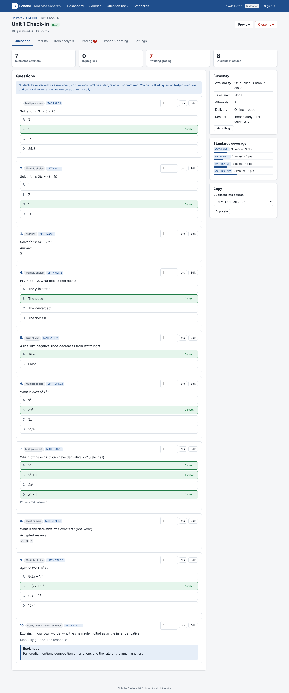
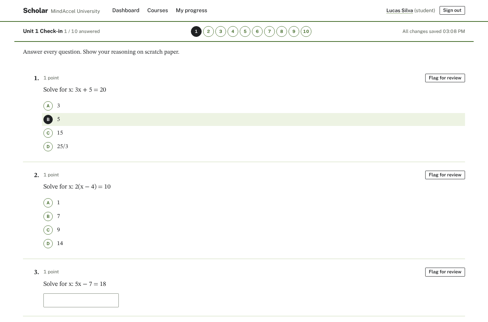
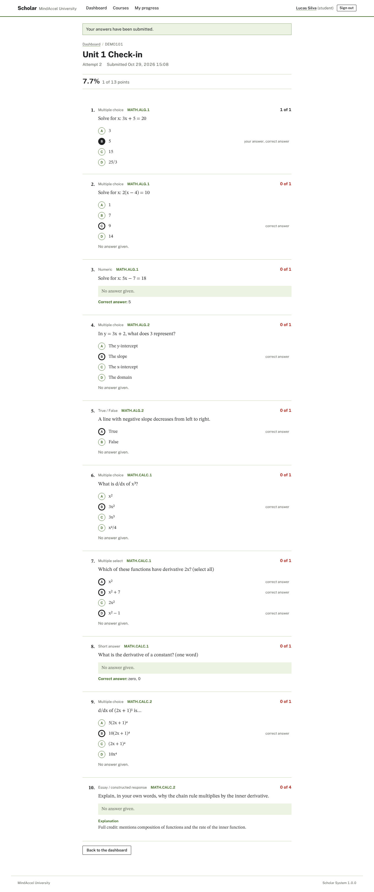
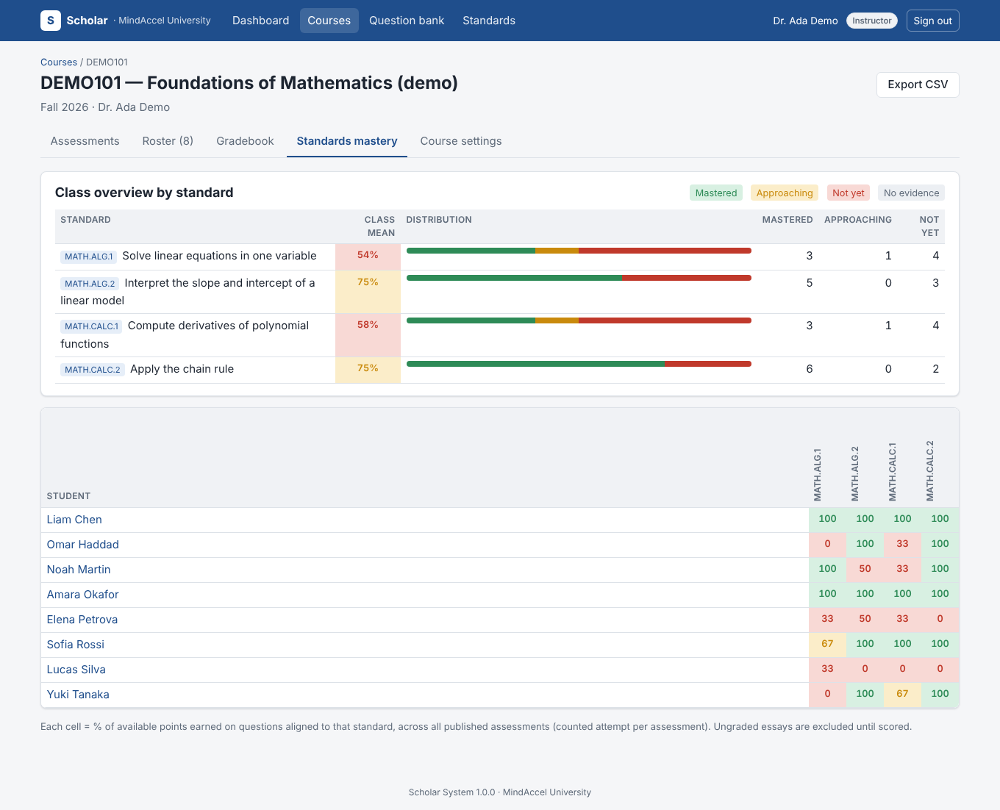
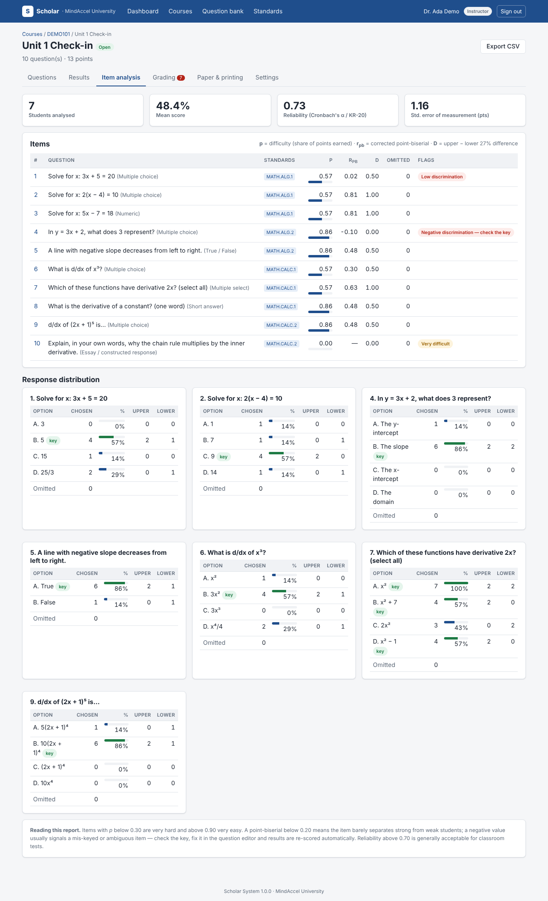

# Scholar System for YunoHost

Standards-based assessment, online/paper testing and mastery tracking for **MindAccel University**, packaged for [YunoHost](https://yunohost.org).



## Overview

Scholar System is a self-hosted testing platform in the spirit of Mastery Manager:

- **Question bank** — multiple choice, multiple select, true/false, short answer, numeric and essay questions, aligned to standards / learning outcomes, shared between instructors, CSV import.
- **Assessments** — availability windows, time limits, attempt limits, access codes, shuffling, results-release policy.
- **Online testing** — autosave, server-enforced timer with auto-submit, question navigator, flag for review.
- **Paper testing with phone scanning** — print a full-page answer sheet for each student (longer tests continue on more pages), then photograph the completed sheets with a phone. Scholar straightens each photo, identifies the student and page from the code printed on it, and reads the bubbles; clean sheets are recorded in one click and doubtful marks or handwritten answers are shown cropped for a quick check. Keyed entry (`A`, `AC`, `T`) and CSV import are still there.
- **Grading** — automatic scoring, essay grading queue (by student or by question), overrides with feedback, automatic re-scoring when a key is corrected.
- **Reports** — score distribution, item analysis (p-value, point-biserial, D-index, distractors, Cronbach's α / KR-20, SEM), gradebook, standards-mastery heat map, student reports, CSV exports everywhere.
- **Administration** — roles, CSV user/roster import, mastery thresholds, time zone, audit log.

| Taking a test | Reviewing a marked paper | Standards mastery | Item analysis |
|---|---|---|---|
|  |  |  |  |

### Design

The interface is modelled on the paperwork of the exam room: answer sheets printed in dropout-green ink, graphite pencil marks, the grader's red pen, and exam papers set in a scientific serif. Choices are answer bubbles you fill in; questions are set in STIX Two Text and the interface in Public Sans (both SIL OFL, bundled in `static/fonts/`, no CDN). The full design contract (colours, type, layout rules, and the defaults it deliberately avoids) is in [DESIGN.md](DESIGN.md).

## YunoHost integration

| | |
|---|---|
| Multi-instance | ✅ |
| LDAP (YunoHost accounts) | ✅ sign in with the YunoHost username/password |
| SSO (SSOwat) | ✅ users signed into the portal are logged in automatically |
| Local accounts | ✅ for students without a YunoHost account |
| Backup / restore | ✅ (PostgreSQL dump + install dir) |
| Change URL | ✅ |
| fail2ban | ✅ failed sign-ins are banned |
| Stack | Python 3 (Flask, SQLAlchemy) · gunicorn · PostgreSQL · nginx |

Requires YunoHost ≥ 12.0.9 (Debian 12, packaging v2, helpers 2.1).

## Installation

```bash
sudo yunohost app install https://github.com/GZPlaz/scholar-system_ynh
```

You'll be asked for the domain and path (default `/scholar`), who may access the app, the YunoHost user who becomes the first administrator, and your institution name. The install downloads the Python dependencies from PyPI, so the server needs outbound internet access during install/upgrade.

Upgrade:

```bash
sudo yunohost app upgrade scholar-system -u https://github.com/GZPlaz/scholar-system_ynh
```

See [doc/ADMIN.md](doc/ADMIN.md) for first steps, access-control choices and command-line tools.

## Repository layout

```
manifest.toml        YunoHost v2 manifest (resources: user, dir, port, apt, PostgreSQL, permission)
conf/                nginx, systemd, gunicorn and app configuration templates
scripts/             install / remove / upgrade / backup / restore / change_url
sources/             the application itself (Flask package `scholar`, manage.py, wsgi.py)
DESIGN.md            the UI design contract every template follows
tests/               end-to-end test suite (pytest)
doc/                 YunoHost description, admin docs, screenshots
```

## Development

```bash
python3 -m venv .venv && .venv/bin/pip install -r sources/requirements.txt pytest
.venv/bin/pytest -q tests                                   # SQLite
SCHOLAR_TEST_DATABASE_URL=postgresql+psycopg2://user:pw@localhost/scholar_test .venv/bin/pytest -q tests

cd sources
../.venv/bin/python manage.py init-db
../.venv/bin/python manage.py create-local-admin admin --password changeme123
../.venv/bin/python manage.py seed-demo
../.venv/bin/flask --app wsgi run --debug    # http://127.0.0.1:5000
```

Without a `scholar.env` file the app uses a local SQLite database (`sources/scholar-dev.sqlite3`) and disables LDAP/SSO.

## License

MIT — see [LICENSE](LICENSE).
